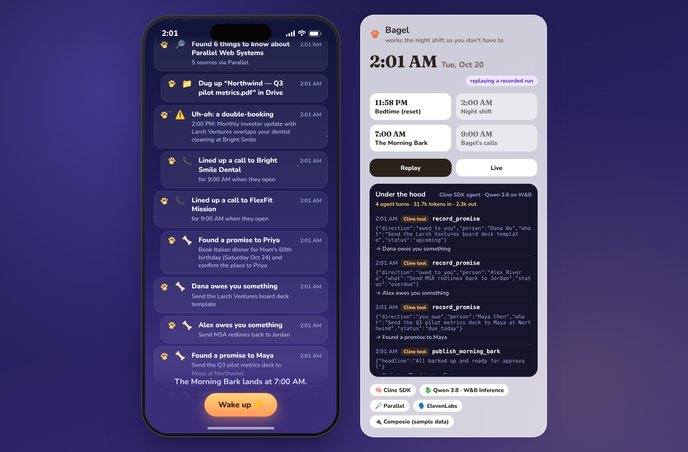
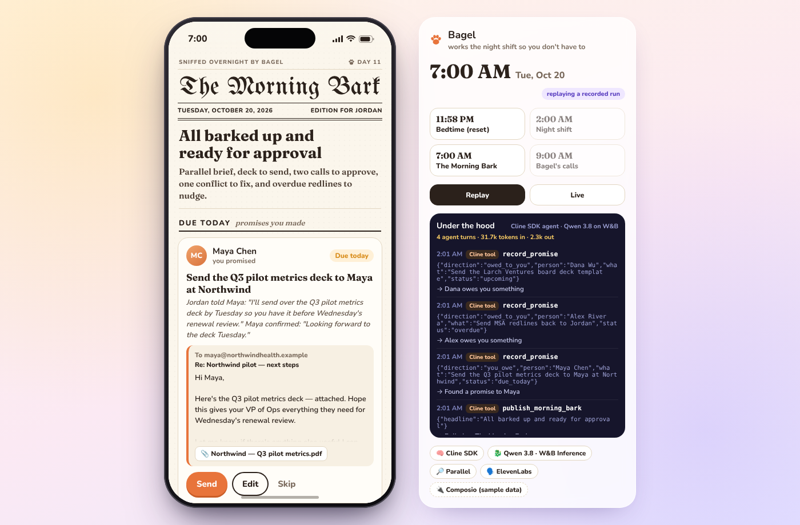
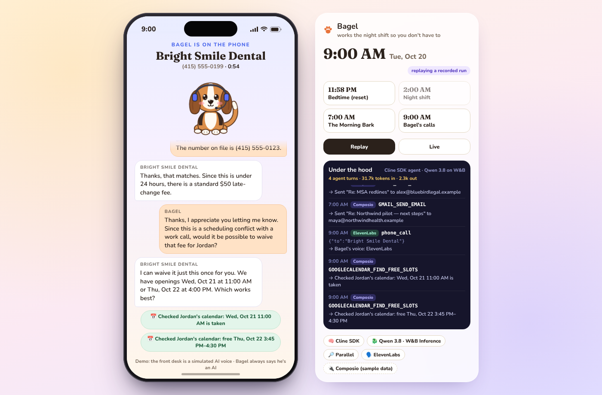
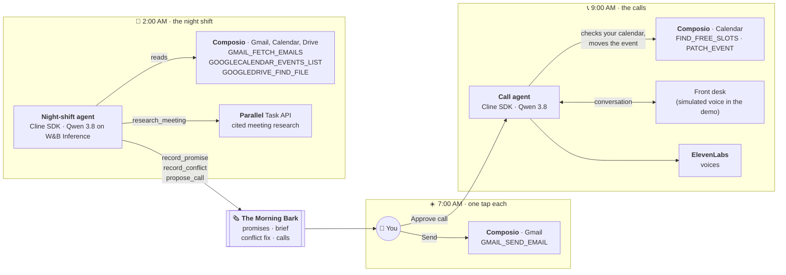

<p align="center"></p>

<h1 align="center">Bagel works the night shift</h1>

<p align="center"><b>A personal agent you'll actually use every day.</b><br>
While you sleep, Bagel the beagle preps tomorrow. At 7:00 AM he drops <i>The Morning Bark</i> at your door:<br>
every promise you made, every reply you're owed, a brief for your first meeting, and the awkward calls, already lined up.<br>
One tap each. Then at 9:00 he makes the calls.</p>

<p align="center">Open source, open weights · Runs on your machine · Your choice of model</p>

<p align="center"><b>▶ <a href="https://www.youtube.com/watch?v=t3OLx-MCzSU">Watch the demo on YouTube</a></b> · <a href="slides.pdf">Slides</a> · <a href="PITCH.md">Pitch</a></p>

---

## The problem and our solution

**The problem.** Personal agents like Muse and Instinct are good at errands, but only when you remember to ask. What drains a day is the work nobody asks for: the deck you promised by Tuesday, the redlines you're still owed, a first meeting with zero prep, a dentist appointment that clashes with your investor update, a gym that only cancels by phone. It's scattered across your inbox and calendar, and the worst of it takes a phone call. Those assistants are also closed: their app, their model.

**Our solution.** Bagel doesn't wait to be asked. He keeps a daily routine: overnight he reads your inbox and calendar and finds that work, at 7 AM he hands it to you already done (drafts with the file attached, a cited brief, a fix for the clash), and at 9 AM he makes the calls. You approve each item with one tap. Nothing is sent without you, and on the phone he always says he's an AI. He's open source, lives on your machine, and runs on open-weights models you choose, Qwen 3.8 today.

## The daily loop

| When | What Bagel does |
| --- | --- |
| **2:00 AM** · the night shift | Reads tomorrow's calendar and your inbox, finds commitments in both directions, researches first-time meetings, spots double-bookings, and lines up phone calls. Every step shows up as a paw print on the trail. |
| **7:00 AM** · *The Morning Bark* | A newspaper of ready-to-approve work: drafts with the right file already attached, nudges for overdue replies, a cited meeting brief, a fix for the double-booking. Nothing is sent without your tap. |
| **9:00 AM** · the awkward calls | When the business opens, Bagel calls: moves the dentist that clashes with your investor update (checking your calendar mid-call), cancels the gym you haven't visited since August, declines the retention offers, and asks for the late fee to be waived. Then he updates your calendar. |

| Night shift | The Morning Bark | On the phone |
| --- | --- | --- |
|  |  |  |

### Next shift: your backlog

Because Bagel runs on your machine, he can reach things a chat assistant can't, like your repos. Next up: overnight, Bagel hands the GitHub issues you've labeled to Cline (or `claude -p`) on your machine, each in its own branch. By 7 AM there's a draft PR with the tests run, as one more card in *The Morning Bark*. You still tap to merge. This isn't in the hackathon build yet.

Bagel does the work, so you can go play frisbee with your dog.

## Architecture



The phone app (React) talks to a small Express server over server-sent events. The server owns a demo clock, so the night shift, the 7:00 AM paper and the 9:00 AM calls can run on schedule or be skipped to on stage. Each tool call the agents make becomes a paw print on the trail and a line in the app's "under the hood" log.

## Built with

- **Cline SDK** (`@cline/sdk`) is Bagel's brain, twice: the night-shift agent (`server/agent/nightshift.ts`) and Bagel on the phone (`server/caller/call.ts`). It uses custom tools built with `createTool`, completion tools (`publish_morning_bark`, `end_call`), and the SDK's event stream, which drives the trail.
- **Qwen 3.8** (`Qwen/Qwen3.8-27B`) on **W&B Inference**, through Cline's `openai-compatible` provider, with reasoning effort set per job.
- **Parallel** Task API (`base` processor, JSON output schema) researches first meetings and returns a one-liner, recent news, key people and talking points, with sources for every field.
- **Composio**: Bagel reaches your accounts through Composio's tool slugs and argument names (`GMAIL_FETCH_EMAILS`, `GOOGLECALENDAR_EVENTS_LIST`, `GOOGLECALENDAR_FIND_FREE_SLOTS`, `GOOGLECALENDAR_PATCH_EVENT`, `GMAIL_SEND_EMAIL`, `GOOGLEDRIVE_FIND_FILE`). The hackathon build answers them from sample data (`server/integrations/`); connecting real accounts is one swap:

  ```ts
  const session = await new Composio().create(userId)   // Gmail, Calendar, Drive
  const result = await session.execute(slug, args)       // same slugs, same args
  ```
- **ElevenLabs** voices Bagel on the phone (`server/caller/voice.ts`), mixed with a ringback tone and a phone-line filter.

## Run it

```bash
npm install
npm run dev            # app on http://localhost:5173
```

It starts in replay mode, which plays back a recorded run and needs no keys. To run the agents live, copy `.env.example` to `.env`, add the keys, and press **Live** in the side panel.

Bagel uses Qwen 3.8, an open-weights model, on W&B Inference by default, but the model is your choice. Point `LLM_BASE_URL` and `LLM_MODEL` at any OpenAI-compatible endpoint whose model supports tool calls, and put its key in `LLM_API_KEY`. A model running locally with Ollama or vLLM works too; any non-empty key will do.

## Project layout

```
server/agent/          the night-shift agent
server/caller/         Bagel on the phone + voices
server/research/       Parallel meeting briefs
server/integrations/   Composio-shaped tools over sample data
server/engine.ts       demo clock, approvals, call queue
web/src/               the phone app: Bagel, the night trail, The Morning Bark, the call screen
```
